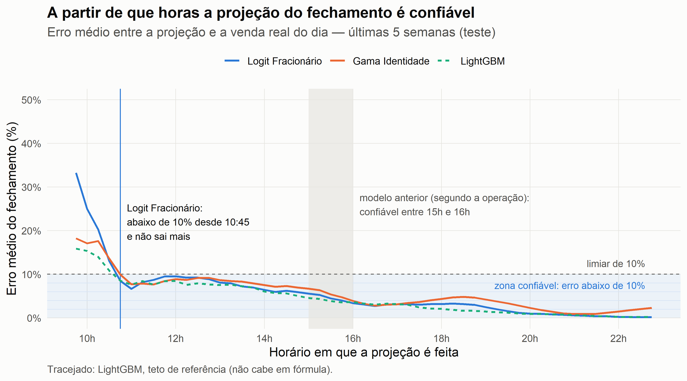
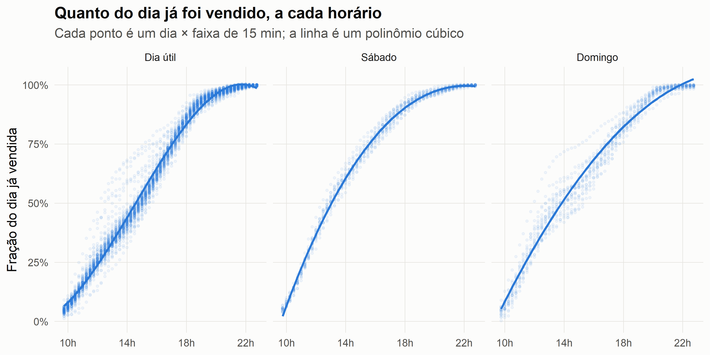

🇧🇷 [Versão em português](README.pt-BR.md)

# Intraday Sales Forecast

> Forecast the day's closing sales from the first hours of trading, with a formula simple enough to run inside Tableau, so the business can change course during the day, not after it.

**The closing projection drops below 10% error at 10:45 and stays there for the rest of the day.** According to the operations team, the previous model only got there between 3 pm and 4 pm.



## Problem

A Brazilian durable-goods retailer steered its day by a closing-sales projection: leadership and store operations checked it throughout the day and adjusted promotions and priorities. The previous projection lived in a legacy system nobody could explain, and according to the team that used it, it only became trustworthy between **3 pm and 4 pm**, when most of the day's sales had already happened.

The replacement had a hard constraint: it had to be a **Tableau calculated field**. There was no model server and no scheduled scoring job, only a formula.

## The metric: reliable-from time

The business question is "from what time can I trust the projection?". **The reliable-from time is the first time of day after which the projection stays within 10% of the actual result and never leaves that band until closing.** Touching 10% once is not enough.

The metric comes from the business. Managers used the projection to change course during the day, so they needed a trustworthy number as early as possible, and they set 10% as the acceptable error for making decisions. It is measured on the average error across the 35 test days, and it picks the model and ranks the results table.

## Approach

- **Target:** the share of the day already sold at each 15-minute slot (`sales so far / day's total`). The closing projection is `sales so far / predicted share`. Because the target is a ratio, the model learns the *shape* of the day, not its level.
- **Inputs:** only what Tableau can compute from the clock: time of day as a fraction of 24h, plus Saturday and Sunday flags.
- **Model:** supervised learning with a regression model: a cubic polynomial of the time of day, interacted with Saturday and Sunday, estimated by a **fractional logit** (quasi-binomial GLM). The target is a share, and the logit keeps the prediction between 0 and 1. That is **12 coefficients**, and the Tableau formula is `1 / (1 + EXP(-polynomial))`.
- **Selection:** the same polynomial was fitted with other families (Gamma, Tweedie, inverse Gaussian, robust, quantile and Tobit regression, trees). Among those that fit in a formula, the one that becomes reliable earliest wins; ties go to the error of the 11:00 projection.
- **Validation:** split **by day and in time**: train on February to May, test on the last 5 weeks. A day the model has never seen is the real use case; shuffling 15-minute rows would leak each test day into training.
- **Reference ceiling:** LightGBM, XGBoost and a quantile additive model (`qgam`) get *the same inputs*. They do not fit in a formula and are there to measure what the constraint costs. Since they would never be deployed, their hyperparameters were not tuned.



## Results

Test period: last 5 weeks (35 days). Error = absolute % error of the closing projection.

| Model | Fits in a Tableau / Power BI / Excel formula? | Reliable (<10%) from | Error at 11:00 | Mean error (all slots) |
|---|---|---|---|---|
| **Polynomial, fractional logit (this repo)** | Yes, 12 coefficients | **10:45** | **6.66%** | 5.55% |
| Polynomial, Gamma GLM | Yes, 12 coefficients | 10:45 | 7.72% | 5.80% |
| Polynomial, robust regression | Yes, 12 coefficients | 13:00 | 7.60% | 6.18% |
| qgam (reference ceiling) | Not in practice (splines) | 10:45 | 7.37% | 4.65% |
| LightGBM (reference ceiling) | No, 500 trees | 10:45 | 7.60% | 4.49% |
| Previous model (operations team's account, not measured) | n/a | between 15:00 and 16:00 | n/a | n/a |

- The formula becomes reliable at 10:45, the same time as the models that do not fit in a formula. With a 5% threshold, it is reliable from 15:30.
- The formula constraint costs mean error (5.55% vs 4.49% for LightGBM) but no time: both reach 10% at 10:45. At 11:00 the formula is more accurate than the reference models.
- The full comparison of 14 models is in [`analysis/01-forecast.md`](analysis/01-forecast.md). Rendering the notebook locally also produces an HTML version with a sortable table.

## Data

The source data are proprietary and not distributed. The repository ships the derived table the model needs: the share of the day sold per day × 15-minute slot, with no monetary values. See [`data/README.md`](data/README.md).

## Stack

R · `stats::glm`, `MASS` · `rsample`, `yardstick` · `lightgbm`, `xgboost`, `qgam` (reference ceiling) · `ggplot2` · `renv` · Tableau (deployment)

## Reproducing

```r
renv::restore()                                   # exact package versions from renv.lock
rmarkdown::render("analysis/01-forecast.Rmd", output_format = "all")
```

`R/00_extract.R` rebuilds `data/intraday_fraction.csv` from the raw export. It needs the raw files and a local `_local/config.R` (described at the top of the script).

## Notes

- Before 10:45 no model is reliable. Up to 10:15 the Gamma GLM is more accurate than the logit (18% vs 33% at 09:45); from 10:30 on the logit is ahead or level. If the business wants a better number in the first hour, one option is a Tableau `IF` on the time of day: the Gamma formula until 10:15, the logit after.
- The early error is large because very little of the day has been sold yet, and that little varies a lot between days: among days of the same type, the coefficient of variation of the share sold is 0.25 at 10:00, 0.13 at noon and 0.06 at 16:00. The projection divides by that share, so a small early deviation becomes a large closing error.
- The inputs are only the clock and the weekday. Promotions, holidays and campaigns are not in the model. Corpus Christi (June 19) falls in the test period: Thursday only becomes reliable at 15:15 in the [weekday heatmap](assets/03-heatmap-horario-dia-1.png), against 10:30 to 12:45 on the other days.
- The source table refreshed every 15 minutes, so the 15-minute grid matches what the business actually saw.
