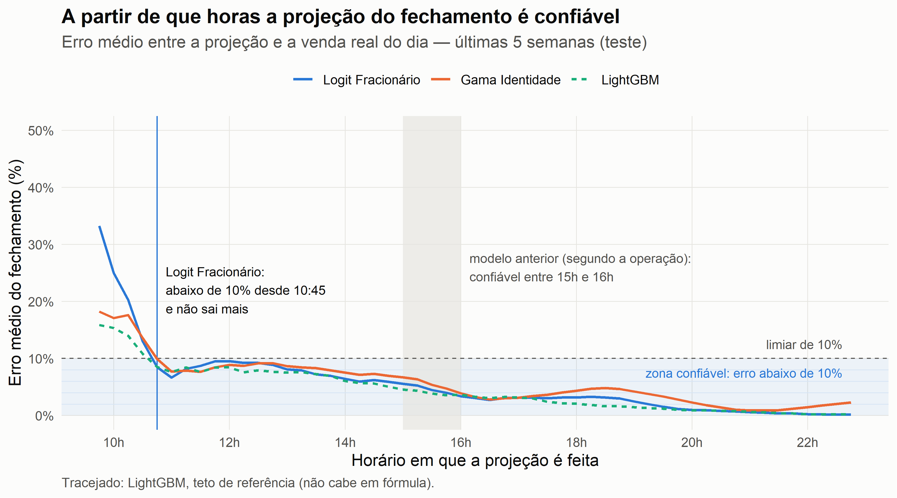
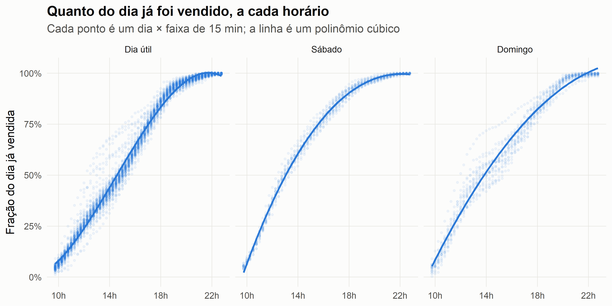

🇺🇸 [English version](README.md)

# Projeção Intradiária de Vendas

> Prever o fechamento da venda do dia já nas primeiras horas, com uma fórmula simples o bastante para rodar no Tableau, para a empresa corrigir a estratégia ao longo do dia, e não depois.

**A projeção do fechamento fica abaixo de 10% de erro a partir das 10:45 e não sai mais.** Segundo a operação, o modelo anterior só chegava a esse ponto entre 15h e 16h.



## Problema

Um varejista brasileiro de bens duráveis conduzia o dia por uma projeção do fechamento das vendas: diretoria e operação de lojas acompanhavam o número ao longo do dia e ajustavam promoções e prioridades. A projeção anterior vivia num sistema legado que ninguém sabia explicar e, segundo a equipe que a usava, só ficava confiável entre **15h e 16h**, quando a maior parte da venda do dia já tinha acontecido.

A substituta tinha uma restrição dura: precisava ser um **campo calculado do Tableau**. Não havia servidor de modelo nem rotina de escoragem, só uma fórmula.

## A métrica: horário confiável

A pergunta da operação é "a partir de que horas posso confiar na projeção?". **O horário confiável é o primeiro horário do dia a partir do qual a projeção fica a menos de 10% da venda real e não passa mais desse limite até o fim do dia.** Não basta tocar os 10% uma vez.

A métrica vem do negócio. Os gestores usavam a projeção para corrigir a estratégia durante o dia, então precisavam de um número confiável o mais cedo possível, e definiram 10% como o erro aceitável para tomar decisão. Ela é medida sobre o erro médio dos 35 dias de teste, escolhe o modelo e ordena a tabela de resultados.

## Abordagem

- **Alvo:** a fração do dia já vendida a cada faixa de 15 minutos (`venda acumulada / venda do dia`). A projeção do fechamento é `venda acumulada / fração prevista`. Como o alvo é uma razão, o modelo aprende o *formato* do dia, não o nível.
- **Variáveis:** só o que o Tableau calcula a partir do relógio: o horário como fração de 24h, mais indicadores de sábado e domingo.
- **Modelo:** aprendizado supervisionado com um modelo de regressão: um polinômio cúbico do horário, com interação por sábado e domingo, estimado por um **logit fracionário** (GLM quasi-binomial). O alvo é uma fração, e o logit mantém a previsão entre 0 e 1. São **12 coeficientes**, e a fórmula do Tableau é `1 / (1 + EXP(-polinômio))`.
- **Escolha:** o mesmo polinômio foi estimado por outras famílias (Gama, Tweedie, inversa gaussiana, regressão robusta, quantílica, Tobit, árvores). Entre os que cabem em fórmula, vence o que fica confiável mais cedo; empates vão para o erro da projeção às 11h.
- **Validação:** divisão **por dia e no tempo**: treino de fevereiro a maio, teste nas últimas 5 semanas. Um dia que o modelo nunca viu é o caso real de uso; sortear linhas de 15 minutos vazaria cada dia de teste para o treino.
- **Teto de referência:** LightGBM, XGBoost e um modelo aditivo quantílico (`qgam`) recebem *as mesmas variáveis*. Eles não cabem numa fórmula e servem para medir quanto a restrição custa. Como nunca iriam para produção, os hiperparâmetros não foram otimizados.



## Resultados

Período de teste: últimas 5 semanas (35 dias). Erro = erro percentual absoluto da projeção do fechamento.

| Modelo | Cabe numa fórmula de Tableau / Power BI / Excel? | Confiável (<10%) desde | Erro às 11h | Erro médio (todos os horários) |
|---|---|---|---|---|
| **Polinômio, logit fracionário (este repositório)** | Sim, 12 coeficientes | **10:45** | **6,66%** | 5,55% |
| Polinômio, GLM Gama | Sim, 12 coeficientes | 10:45 | 7,72% | 5,80% |
| Polinômio, regressão robusta | Sim, 12 coeficientes | 13:00 | 7,60% | 6,18% |
| qgam (teto de referência) | Não na prática (splines) | 10:45 | 7,37% | 4,65% |
| LightGBM (teto de referência) | Não, 500 árvores | 10:45 | 7,60% | 4,49% |
| Modelo anterior (relato da operação, não medido) | n/d | entre 15:00 e 16:00 | n/d | n/d |

- A fórmula fica confiável às 10:45, o mesmo horário dos modelos que não cabem em fórmula. Com limiar de 5%, fica confiável desde 15:30.
- A restrição de fórmula custa erro médio (5,55% contra 4,49% do LightGBM), mas não custa tempo: os dois chegam a 10% às 10:45. Às 11h, a fórmula erra menos que os modelos de referência.
- A comparação completa de 14 modelos está em [`analysis/01-forecast.md`](analysis/01-forecast.md). Renderizar o notebook localmente gera também uma versão HTML com a tabela ordenável.

## Dados

Os dados de origem são proprietários e não são distribuídos. O repositório inclui a tabela derivada de que o modelo precisa: a fração do dia vendida por dia × faixa de 15 minutos, sem nenhum valor monetário. Ver [`data/README.md`](data/README.md).

## Stack

R · `stats::glm`, `MASS` · `rsample`, `yardstick` · `lightgbm`, `xgboost`, `qgam` (teto de referência) · `ggplot2` · `renv` · Tableau (deploy)

## Reproduzindo

```r
renv::restore()                                   # versões exatas dos pacotes, do renv.lock
rmarkdown::render("analysis/01-forecast.Rmd", output_format = "all")
```

`R/00_extract.R` regera `data/intraday_fraction.csv` a partir da extração bruta. Ele precisa dos arquivos brutos e de um `_local/config.R` local (descrito no topo do script).

## Observações

- Antes das 10:45 nenhum modelo é confiável. Até 10:15 o GLM Gama erra menos que o logit (18% contra 33% às 09:45); a partir de 10:30 o logit empata ou passa à frente. Se a operação quiser um número melhor já na primeira hora, uma opção é um `IF` pelo horário no Tableau: a fórmula da Gama até 10:15 e a do logit depois.
- O erro é grande cedo porque se vendeu muito pouco do dia, e esse pouco varia muito entre os dias: entre dias do mesmo tipo, o coeficiente de variação da fração vendida é 0,25 às 10h, 0,13 ao meio-dia e 0,06 às 16h. A projeção divide por essa fração, então um desvio pequeno logo cedo vira um erro grande no fechamento.
- As variáveis são só o relógio e o dia da semana. Promoções, feriados e campanhas não estão no modelo. Corpus Christi (19/06) cai no período de teste: a quinta-feira só fica confiável às 15:15 no [heatmap por dia da semana](assets/03-heatmap-horario-dia-1.png), contra 10:30 a 12:45 nos outros dias.
- A tabela de origem atualizava a cada 15 minutos, então a grade de 15 minutos corresponde ao que a operação via de fato.
