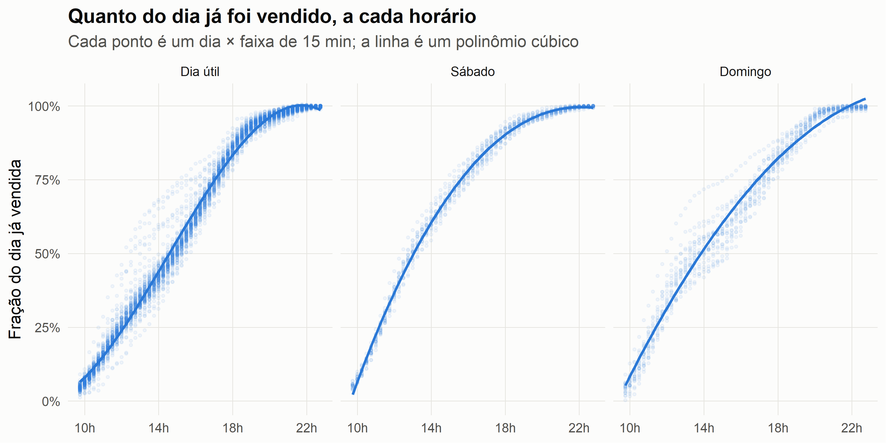
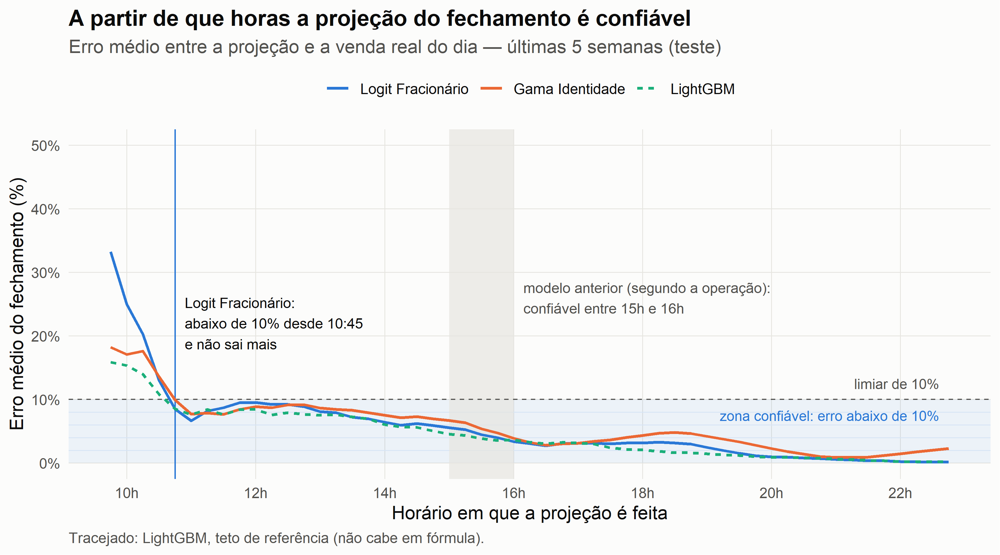
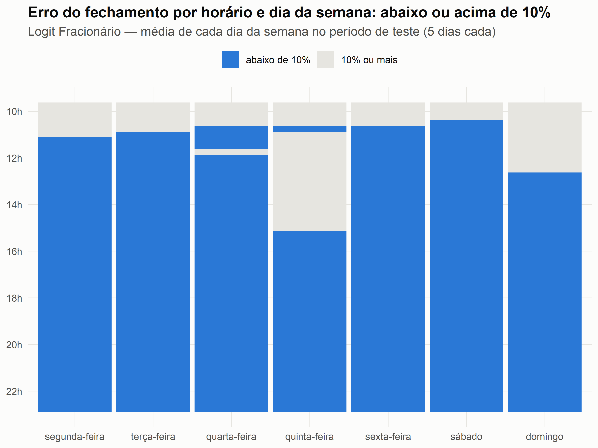

Projeção da venda do dia: modelo intradiário
================

- [Dados](#dados)
- [Análise exploratória](#análise-exploratória)
- [Divisão treino/teste por dia, no
  tempo](#divisão-treinoteste-por-dia-no-tempo)
- [A métrica: horário confiável](#a-métrica-horário-confiável)
- [Modelagem](#modelagem)
- [Resultados](#resultados)
- [Horário confiável: modelo ×
  alternativas](#horário-confiável-modelo--alternativas)
  - [Antes das 10:45: a manhã](#antes-das-1045-a-manhã)
- [Onde o modelo erra: horário × dia da
  semana](#onde-o-modelo-erra-horário--dia-da-semana)
- [A fórmula que vai para o
  Dashboard](#a-fórmula-que-vai-para-o-dashboard)

Projeção do fechamento da venda do dia a partir das primeiras horas, com
um modelo que cabe numa fórmula de Tableau, Power BI ou Excel.

É um problema de **aprendizado supervisionado**, resolvido com um
**modelo de regressão**: a partir do histórico, o modelo aprende qual
fração da venda do dia já aconteceu em cada horário, e a projeção do
fechamento é a venda acumulada dividida por essa fração. As variáveis
são só o horário e o dia da semana (dia útil, sábado ou domingo),
combinados num polinômio cúbico do horário com interação por sábado e
domingo: 12 coeficientes. Como o alvo é uma proporção entre 0 e 1, o
modelo é um **modelo linear generalizado (GLM)** da família
quasi-binomial com link logit, conhecido como **logit fracionário**: ele
mantém a previsão sempre entre 0 e 1.

A métrica que guia o projeto é o **horário confiável**: a partir de que
horas a projeção do fechamento fica abaixo de 10% de erro e não sai
mais. Ela veio da regra de negócio, não da estatística. Os gestores
usavam a projeção para corrigir a estratégia durante o dia, então
precisavam de um número confiável **o mais cedo possível**, e definiram
10% como o erro aceitável para tomar decisão. O modelo anterior, segundo
a operação, só chegava a esse patamar entre 15h e 16h, quando boa parte
da venda do dia já tinha acontecido. Por isso é a métrica que escolhe o
modelo, ordena a tabela de resultados e organiza os gráficos.

Este arquivo é renderizado em dois formatos: o `.md` (estático, lido
direto no GitHub) e o `.html` (com a tabela de modelos interativa, que
pode ser ordenada e filtrada).

``` r
library(data.table)
library(dplyr)
library(tidyr)
library(ggplot2)
library(rsample)

source(here::here("R", "functions.R"))

## Limiar do horário confiável (erro % do fechamento)
LIMIAR   <- 10   # principal: textos, gráficos e escolha do modelo
LIMIAR_2 <- 5    # secundário: só reportado
```

## Dados

A base é a fração do dia já vendida
(`Multiplicador = venda acumulada / venda do dia`) a cada 15 minutos,
das 09:45 às 22:45. Ela é gerada por `R/00_extract.R` a partir da
extração bruta, que não é distribuída. Nenhum valor em R\$ está aqui.

``` r
base_final <- fread(here::here("data", "intraday_fraction.csv")) |>
  mutate(Data = as.Date(Data), Hora = as.character(Hora)) |>
  arrange(Data, Hora)

## Dia do mês
base_final <- base_final |>
  mutate(periodo_mes = case_when(
    mday(Data) <= 10 ~ "1 a 10",
    mday(Data) <= 20 ~ "11 a 20",
    TRUE            ~ "21 ou mais"
  ))

## Dummies de dia da semana
base_final <- base_final |>
  mutate(sabado   = factor(as.integer(dia_semana == "sábado")),
         domingo  = factor(as.integer(dia_semana == "domingo")),
         tipo_dia = factor(case_when(dia_semana == "sábado"  ~ "Sábado",
                                     dia_semana == "domingo" ~ "Domingo",
                                     TRUE                    ~ "Dia útil"),
                           levels = c("Dia útil", "Sábado", "Domingo")))

glimpse(base_final)
```

    Rows: 7,685
    Columns: 9
    $ Data          <date> 2025-02-01, 2025-02-01, 2025-02-01, 2025-02-01, 2025-02…
    $ Hora          <chr> "09:45", "10:00", "10:15", "10:30", "10:45", "11:00", "1…
    $ dia_semana    <chr> "sábado", "sábado", "sábado", "sábado", "sábado", "sábad…
    $ perc_dia      <dbl> 0.406250, 0.416667, 0.427083, 0.437500, 0.447917, 0.4583…
    $ Multiplicador <dbl> 0.042663, 0.061939, 0.086026, 0.110468, 0.138308, 0.1723…
    $ periodo_mes   <chr> "1 a 10", "1 a 10", "1 a 10", "1 a 10", "1 a 10", "1 a 1…
    $ sabado        <fct> 1, 1, 1, 1, 1, 1, 1, 1, 1, 1, 1, 1, 1, 1, 1, 1, 1, 1, 1,…
    $ domingo       <fct> 0, 0, 0, 0, 0, 0, 0, 0, 0, 0, 0, 0, 0, 0, 0, 0, 0, 0, 0,…
    $ tipo_dia      <fct> Sábado, Sábado, Sábado, Sábado, Sábado, Sábado, Sábado, …

``` r
cat(uniqueN(base_final$Data), "dias, de", format(min(base_final$Data)), "a", format(max(base_final$Data)))
```

    145 dias, de 2025-02-01 a 2025-06-25

## Análise exploratória

``` r
base_final |>
  select(Multiplicador, perc_dia) |>
  psych::describe(fast = TRUE) |>
  round(3)
```

                  vars    n mean   sd median  min  max range skew kurtosis se
    Multiplicador    1 7685 0.64 0.31   0.69 0.00 1.00  1.00 -0.4    -1.24  0
    perc_dia         2 7685 0.68 0.16   0.68 0.41 0.95  0.54  0.0    -1.20  0

``` r
## Correlação (Spearman) entre a fração vendida e o percentual do dia
cor(base_final$Multiplicador, base_final$perc_dia, method = "spearman")
```

    [1] 0.9879659

``` r
## Frequências das categóricas
base_final |> count(dia_semana) |> mutate(perc = round(100 * n / sum(n), 1))
```

          dia_semana     n  perc
              <char> <int> <num>
    1:       domingo  1113  14.5
    2:  quarta-feira  1113  14.5
    3:  quinta-feira  1060  13.8
    4: segunda-feira  1113  14.5
    5:   sexta-feira  1060  13.8
    6:        sábado  1113  14.5
    7:   terça-feira  1113  14.5

``` r
base_final |> count(periodo_mes) |> mutate(perc = round(100 * n / sum(n), 1))
```

       periodo_mes     n  perc
            <char> <int> <num>
    1:      1 a 10  2650  34.5
    2:     11 a 20  2650  34.5
    3:  21 ou mais  2385  31.0

A relação entre o horário e a fração vendida é não linear e muda no fim
de semana. É isso que justifica o polinômio cúbico com interação por
sábado e domingo. Foi testado um polinômio de grau 4, porém ocasionou
overfitting, devido a complexidade do modelo.

``` r
g_curva <- ggplot(base_final, aes(perc_dia * 24, Multiplicador)) +
  geom_point(colour = paleta[1], alpha = 0.06, size = 0.8) +
  geom_smooth(method = "lm", formula = y ~ poly(x, 3, raw = TRUE),
              colour = paleta[1], linewidth = 1, se = FALSE) +
  facet_wrap(~ tipo_dia) +
  scale_x_continuous(breaks = seq(10, 22, 4), labels = function(x) paste0(x, "h")) +
  scale_y_continuous(labels = scales::percent) +
  labs(title = "Quanto do dia já foi vendido, a cada horário",
       subtitle = "Cada ponto é um dia × faixa de 15 min; a linha é um polinômio cúbico",
       x = NULL, y = "Fração do dia já vendida") +
  tema()
g_curva
```

<!-- -->

## Divisão treino/teste por dia, no tempo

O modelo encara um dia inteiro que nunca viu. Por isso a unidade da
divisão é o dia, e o teste são as **últimas 5 semanas**: treina no
passado, testa no futuro. Sortear linhas de 15 minutos poria fatias do
mesmo dia no treino e no teste, e a métrica sairia otimista.

``` r
corte <- max(base_final$Data) - 34   # 35 dias de teste

divisao <- make_splits(
  list(analysis   = which(base_final$Data <  corte),
       assessment = which(base_final$Data >= corte)),
  data = base_final
)

dados_treino <- training(divisao)
dados_teste  <- testing(divisao)

c(dias_treino = uniqueN(dados_treino$Data), dias_teste = uniqueN(dados_teste$Data))
```

    dias_treino  dias_teste 
            110          35 

## A métrica: horário confiável

A operação acompanha a projeção ao longo do dia e quer saber **a partir
de que horas pode confiar nela**. A métrica responde exatamente isso:

- **erro de um horário** = média, sobre os dias de teste, de \|projeção
  do fechamento ÷ venda real do dia − 1\| × 100, com projeção = venda
  acumulada ÷ previsão do modelo. Como a venda acumulada se cancela, o
  erro sai da fração normalizada, sem nenhum valor em R\$;
- **horário confiável** = o primeiro horário de 15 minutos a partir do
  qual o erro de **todos** os horários seguintes do dia fica abaixo do
  limiar (`LIMIAR` = 10%). Não basta passar abaixo de 10% uma vez: a
  projeção tem que ficar abaixo e não sair mais.

Contexto: segundo a operação, o modelo anterior só passava a ser
confiável entre as 15h e as 16h. Ele não está nos dados, então esse
horário é um relato, não uma medida.

## Modelagem

Foram comparados 14 modelos, em dois grupos:

- **Candidatos que cabem numa fórmula:** modelos de regressão sobre o
  mesmo polinômio, com famílias e funções de perda diferentes: GLMs
  (Gama com link identidade, log e inverso, inversa gaussiana, Tweedie e
  o logit fracionário), regressão robusta, regressão quantílica
  (mediana), regressão truncada em 0-1 (Tobit) e duas árvores de decisão
  rasas, que viram IFs aninhados.
- **Modelos avançados:** LightGBM, XGBoost e um modelo aditivo
  quantílico (`qgam`). Eles não cabem numa fórmula, então não poderiam
  ir para o dashboard. Entram para responder duas perguntas: quão bem um
  modelo complexo se sairia com a mesma informação, e quão perto dele
  chega o melhor modelo possível dentro da restrição. Como não seriam
  usados, os hiperparâmetros não foram otimizados (sem tuning): ficaram
  em valores padrão razoáveis.

O modelo escolhido é o polinômio cúbico do percentual do dia, com
interação por sábado e domingo, estimado por um **logit fracionário**
(GLM quasi-binomial com link logit). O alvo é uma fração entre 0 e 1, e
o logit respeita isso por construção: a previsão nunca sai desse
intervalo. A variância assumida, μ(1 − μ), encolhe nas pontas do dia,
então as manhãs, quando a fração é pequena e qualquer desvio explode na
projeção, pesam no ajuste. Na fórmula, o polinômio entra dentro de
`1 / (1 + EXP(-...))`, ainda com 12 coeficientes.

Os modelos avançados **recebem exatamente as mesmas variáveis** que o
polinômio e servem de **teto de referência**.

``` r
alvo     <- "Multiplicador"
formula_ <- Multiplicador ~ (perc_dia + I(perc_dia^2) + I(perc_dia^3)) * sabado +
                            (perc_dia + I(perc_dia^2) + I(perc_dia^3)) * domingo

set.seed(12)

mdl_1  <- MASS::rlm(formula_, data = dados_treino, maxit = 100)
mdl_3  <- glm(formula_, family = Gamma(link = "inverse"), data = dados_treino)
mdl_5  <- glm(formula_, family = Gamma(link = "log"), data = dados_treino)
mdl_7  <- ajustar_gama(formula_, dados_treino)
mdl_8  <- ajustar_logit(formula_, dados_treino)                   # modelo
mdl_9  <- glm(formula_, family = inverse.gaussian(link = "log"), data = dados_treino)
mdl_11 <- rpart::rpart(Multiplicador ~ perc_dia + I(perc_dia^2) + I(perc_dia^3) + sabado + domingo,
                       data = dados_treino, method = "anova")
mdl_12 <- glm(formula_, family = statmod::tweedie(var.power = 1.5, link.power = 0), data = dados_treino)
mdl_13 <- AER::tobit(formula_, left = 0, right = 1, data = dados_treino)
mdl_14 <- quantreg::rq(formula_, tau = 0.5, data = dados_treino)
mdl_15 <- rpart::rpart(Multiplicador ~ perc_dia + sabado + domingo, data = dados_treino, method = "anova")

## Teto de referência — mesmas variáveis do polinômio (perc_dia, sábado, domingo)
params_lgb <- list(objective = "regression", learning_rate = 0.05, num_leaves = 15,
                   min_data_in_leaf = 20, verbose = -1, num_threads = 1, seed = 12)
ajustar_lgb <- function(dados) {
  lightgbm::lgb.train(params = params_lgb, nrounds = 500,
                      data = lightgbm::lgb.Dataset(matriz_ml(dados), label = dados$Multiplicador))
}
ajustar_xgb <- function(dados) {
  xgboost::xgb.train(params = list(objective = "reg:squarederror", eta = 0.05, max_depth = 4, nthread = 1),
                     data = xgboost::xgb.DMatrix(matriz_ml(dados), label = dados$Multiplicador),
                     nrounds = 500, verbose = 0)
}
ajustar_qgam <- function(dados) {
  invisible(capture.output(
    m <- qgam::qgam(Multiplicador ~ tipo_dia + s(perc_dia, by = tipo_dia, k = 10), data = dados, qu = 0.5)
  ))
  m
}

mdl_lgb  <- ajustar_lgb(dados_treino)
mdl_xgb  <- ajustar_xgb(dados_treino)
mdl_qgam <- ajustar_qgam(dados_treino)

modelos <- list(
  "Regressão Robusta"            = mdl_1,
  "Gama Inversa"                 = mdl_3,
  "Gama Log"                     = mdl_5,
  "Gama Identidade"              = mdl_7,
  "Logit Fracionário"            = mdl_8,
  "Inversa Gaussiana"            = mdl_9,
  "Árvore de Decisão"            = mdl_11,
  "Tweedie"                      = mdl_12,
  "Regressão Truncada"           = mdl_13,
  "Regressão Quantílica"         = mdl_14,
  "Árvore de Decisão 2"          = mdl_15,
  "LightGBM"                     = mdl_lgb,
  "XGBoost"                      = mdl_xgb,
  "Aditivo Quantílico (qgam)"    = mdl_qgam
)
```

## Resultados

A tabela está ordenada pela métrica principal, **Confiável desde
(\<10%)**. Empates são desfeitos pelo erro da projeção feita às 11h
(`MAPE_11h`) e depois pelo erro médio em todos os horários (`MAPE`).
“nunca” quer dizer que o erro não se sustenta abaixo do limiar em nenhum
ponto do dia. A coluna `Confiável desde (<5%)` é a mesma conta com o
limiar de 5%.

Depois vêm as métricas na fração vendida (escala do modelo): ME, MAE,
RMSE, R² tradicional e AIC.

A coluna **Papel** separa o modelo escolhido, os demais candidatos que
cabem num campo calculado do Tableau, numa medida DAX do Power BI ou
numa célula do Excel, e o teto de referência, que não cabe.

``` r
resultados_modelos <- avaliar_modelos(modelos, dados_teste, alvo)

formulas <- lapply(names(modelos), function(m) {
  d <- descrever_formula(modelos[[m]])
  data.frame(Modelo = m, Formula = d$formula)
}) |> bind_rows()

erro_negocio <- lapply(names(modelos), function(m) {
  previsao <- prever(modelos[[m]], dados_teste)
  erro     <- abs(erro_fechamento(dados_teste$Multiplicador, previsao))
  data.frame(Modelo     = m,
             conf       = horario_confiavel(dados_teste, previsao, LIMIAR)$hora,
             conf_2     = horario_confiavel(dados_teste, previsao, LIMIAR_2)$hora,
             MAPE_11h   = round(mean(erro[dados_teste$Hora == "11:00"]), 2),
             MAPE       = round(mean(erro), 2))
}) |> bind_rows()

resultados_modelos <- resultados_modelos |>
  left_join(erro_negocio, by = "Modelo") |>
  left_join(formulas, by = "Modelo") |>
  arrange(hora_para_min(conf), MAPE_11h, MAPE) |>
  mutate(cabe_formula = !startsWith(Formula, "Não"),
         Papel = case_when(!cabe_formula ~ "teto de referência",
                           Modelo == first(Modelo[cabe_formula]) ~ "modelo",
                           TRUE ~ "candidato (fórmula)"),
         across(c(conf, conf_2), ~ coalesce(.x, "nunca"))) |>
  select(Modelo, Papel, Formula,
         `Confiável desde (<10%)` = conf, `Confiável desde (<5%)` = conf_2,
         MAPE_11h, MAPE, ME, Median_Error, MAE, RMSE, R2, AIC)

## O critério escolhe o modelo entre os que cabem em fórmula
modelo_escolhido <- resultados_modelos$Modelo[resultados_modelos$Papel == "modelo"]
modelo_escolhido
```

    [1] "Logit Fracionário"

``` r
## No .html a tabela é interativa (ordenar/filtrar); no .md do GitHub, estática
tabela <- select(resultados_modelos, -Formula)
if (knitr::is_html_output(excludes = c("gfm", "markdown", "markdown_github", "commonmark"))) {
  reactable::reactable(
    tabela, sortable = TRUE, filterable = TRUE, searchable = TRUE,
    defaultPageSize = 20, striped = TRUE, highlight = TRUE, compact = TRUE,
    columns = list(
      Modelo = reactable::colDef(minWidth = 190),
      Papel  = reactable::colDef(minWidth = 150)
    )
  )
} else {
  knitr::kable(tabela)
}
```

| Modelo | Papel | Confiável desde (\<10%) | Confiável desde (\<5%) | MAPE_11h | MAPE | ME | Median_Error | MAE | RMSE | R2 | AIC |
|:---|:---|:---|:---|---:|---:|---:|---:|---:|---:|---:|---:|
| Logit Fracionário | modelo | 10:45 | 15:30 | 6.66 | 5.55 | -0.0042 | -0.0011 | 0.0197 | 0.0322 | 0.9896 | NA |
| Aditivo Quantílico (qgam) | teto de referência | 10:45 | 15:00 | 7.37 | 4.65 | -0.0065 | -0.0027 | 0.0170 | 0.0307 | 0.9906 | -25433.5 |
| LightGBM | teto de referência | 10:45 | 15:00 | 7.60 | 4.49 | -0.0042 | -0.0019 | 0.0168 | 0.0301 | 0.9909 | NA |
| XGBoost | teto de referência | 10:45 | 15:00 | 7.60 | 4.50 | -0.0042 | -0.0020 | 0.0168 | 0.0301 | 0.9909 | NA |
| Gama Identidade | candidato (fórmula) | 10:45 | 15:45 | 7.72 | 5.80 | -0.0045 | -0.0001 | 0.0252 | 0.0364 | 0.9868 | -15686.3 |
| Regressão Truncada | candidato (fórmula) | 11:00 | 15:45 | 7.84 | 6.16 | -0.0041 | -0.0001 | 0.0219 | 0.0339 | 0.9885 | -20896.8 |
| Regressão Quantílica | candidato (fórmula) | 13:00 | 15:30 | 7.46 | 6.09 | -0.0071 | -0.0034 | 0.0220 | 0.0344 | 0.9882 | -23182.3 |
| Regressão Robusta | candidato (fórmula) | 13:00 | 15:30 | 7.60 | 6.18 | -0.0064 | -0.0029 | 0.0220 | 0.0342 | 0.9883 | -21329.5 |
| Tweedie | candidato (fórmula) | 13:00 | nunca | 8.49 | 7.89 | -0.0037 | -0.0037 | 0.0332 | 0.0442 | 0.9805 | NA |
| Árvore de Decisão | candidato (fórmula) | 18:00 | 18:45 | 13.43 | 15.68 | -0.0039 | -0.0091 | 0.0578 | 0.0738 | 0.9455 | NA |
| Árvore de Decisão 2 | candidato (fórmula) | 18:00 | 18:45 | 13.43 | 15.68 | -0.0039 | -0.0091 | 0.0578 | 0.0738 | 0.9455 | NA |
| Gama Inversa | candidato (fórmula) | nunca | nunca | 7.52 | 12.81 | -0.0042 | -0.0070 | 0.0570 | 0.0703 | 0.9506 | -8716.1 |
| Gama Log | candidato (fórmula) | nunca | nunca | 11.17 | 8.68 | -0.0019 | -0.0039 | 0.0427 | 0.0547 | 0.9701 | -13280.8 |
| Inversa Gaussiana | candidato (fórmula) | nunca | nunca | 12.02 | 12.13 | 0.0140 | 0.0041 | 0.0800 | 0.1109 | 0.8769 | -4154.9 |

## Horário confiável: modelo × alternativas

O gráfico compara os **dois melhores modelos que cabem em fórmula** com
o **melhor modelo de árvores** (LightGBM ou XGBoost), o teto de
referência não linear. Todos são escolhidos pela ordem da tabela acima.

``` r
melhores_formula <- resultados_modelos |> filter(Papel != "teto de referência") |> slice_head(n = 2)
melhor_teto      <- resultados_modelos |> filter(startsWith(Formula, "Não (centenas de árvores)")) |> slice_head(n = 1)
comparados       <- c(melhores_formula$Modelo, melhor_teto$Modelo)
cores            <- setNames(paleta, comparados)

previsoes <- lapply(comparados, function(m) prever(modelos[[m]], dados_teste)) |> setNames(comparados)

erro_horario <- lapply(comparados, function(m) {
  horario_confiavel(dados_teste, previsoes[[m]], LIMIAR)$por_slot |> mutate(Modelo = m)
}) |> bind_rows() |>
  mutate(Modelo = factor(Modelo, levels = comparados))

hora_modelo <- horario_confiavel(dados_teste, previsoes[[modelo_escolhido]], LIMIAR)$hora
hora_modelo
```

    [1] "10:45"

``` r
erro_horario |>
  filter(Hora %in% c("09:45", "10:00", "10:45", "11:00", "12:00", "14:00", "16:00", "20:00")) |>
  select(Modelo, Hora, erro) |>
  mutate(erro = round(erro, 1)) |>
  pivot_wider(names_from = Hora, values_from = erro) |>
  knitr::kable()
```

| Modelo            | 09:45 | 10:00 | 10:45 | 11:00 | 12:00 | 14:00 | 16:00 | 20:00 |
|:------------------|------:|------:|------:|------:|------:|------:|------:|------:|
| Logit Fracionário |  33.3 |  25.0 |   8.5 |   6.7 |   9.5 |   6.4 |   3.4 |   1.0 |
| Gama Identidade   |  18.2 |  17.1 |   9.9 |   7.7 |   8.9 |   7.5 |   3.9 |   2.3 |
| LightGBM          |  15.9 |  15.3 |   8.5 |   7.6 |   8.5 |   6.0 |   3.6 |   0.9 |

``` r
x_modelo <- hora_para_min(hora_modelo) / 60

g_erro <- ggplot(erro_horario, aes(perc_dia * 24, erro, colour = Modelo, linetype = Modelo)) +
  ## Faixa abaixo do limiar: onde a projeção é confiável
  annotate("rect", xmin = -Inf, xmax = Inf, ymin = 0, ymax = LIMIAR, fill = paleta[1], alpha = 0.08) +
  geom_hline(yintercept = seq(2, LIMIAR - 2, 2), colour = "#d6e4f5", linewidth = 0.3) +
  annotate("text", x = 22.6, y = LIMIAR - 2.5, hjust = 1, size = 3.2, colour = paleta[1],
           label = paste0("zona confiável: erro abaixo de ", LIMIAR, "%")) +
  annotate("rect", xmin = 15, xmax = 16, ymin = -Inf, ymax = Inf, fill = "#e6e5e0", alpha = 0.7) +
  annotate("text", x = 16.15, y = 26, hjust = 0, size = 3.3, colour = "#52514e",
           label = "modelo anterior (segundo a operação):\nconfiável entre 15h e 16h") +
  geom_hline(yintercept = LIMIAR, linetype = "dashed", colour = "#52514e", linewidth = 0.4) +
  annotate("text", x = 22.6, y = LIMIAR + 2.5, hjust = 1, size = 3.2, colour = "#52514e",
           label = paste0("limiar de ", LIMIAR, "%")) +
  geom_vline(xintercept = x_modelo, colour = paleta[1], linewidth = 0.5) +
  annotate("text", x = x_modelo + 0.15, y = 22, hjust = 0, size = 3.3, colour = "#0b0b0b",
           label = paste0(modelo_escolhido, ":\nabaixo de ", LIMIAR, "% desde ", hora_modelo,
                          "\ne não sai mais")) +
  geom_line(linewidth = 0.9) +
  scale_colour_manual(values = cores) +
  scale_linetype_manual(values = setNames(c("solid", "solid", "22"), comparados)) +
  scale_x_continuous(breaks = seq(10, 22, 2), labels = function(x) paste0(x, "h")) +
  scale_y_continuous(labels = function(x) paste0(x, "%")) +
  coord_cartesian(ylim = c(0, 50)) +
  labs(title = "A partir de que horas a projeção do fechamento é confiável",
       subtitle = "Erro médio entre a projeção e a venda real do dia — últimas 5 semanas (teste)",
       caption = paste0("Tracejado: ", melhor_teto$Modelo, ", teto de referência (não cabe em fórmula)."),
       x = "Horário em que a projeção é feita", y = "Erro médio do fechamento (%)") +
  tema()
g_erro
```

<!-- -->

### Antes das 10:45: a manhã

``` r
## Calculado direto dos dois modelos (não depende de quem entrou no gráfico acima)
manha <- lapply(c("Logit Fracionário", "Gama Identidade"), function(m) {
  horario_confiavel(dados_teste, prever(modelos[[m]], dados_teste), LIMIAR)$por_slot |> mutate(Modelo = m)
}) |> bind_rows() |>
  filter(perc_dia * 24 < 11) |>
  pivot_wider(names_from = Modelo, values_from = erro) |>
  arrange(perc_dia)
virada     <- manha$Hora[which(manha$`Logit Fracionário` <= manha$`Gama Identidade`)[1]]
stopifnot(!is.na(virada), virada != manha$Hora[1])   # o texto abaixo supõe que a Gama começa na frente
gama_ate   <- manha$Hora[which(manha$Hora == virada) - 1]
knitr::kable(manha |> select(-perc_dia) |> mutate(across(where(is.numeric), ~ round(.x, 1))))
```

| Hora  | Logit Fracionário | Gama Identidade |
|:------|------------------:|----------------:|
| 09:45 |              33.3 |            18.2 |
| 10:00 |              25.0 |            17.1 |
| 10:15 |              20.3 |            17.6 |
| 10:30 |              13.0 |            13.6 |
| 10:45 |               8.5 |             9.9 |
| 11:00 |               6.7 |             7.7 |

``` r
## Quanto do dia já foi vendido em cada horário, e quanto isso varia entre dias do mesmo tipo
## (cv = desvio padrão / média da fração, dentro de dia útil, sábado e domingo; média dos três)
fracao_manha <- base_final |>
  filter(Hora %in% c("09:45", "10:00", "10:30", "11:00", "12:00", "14:00", "16:00")) |>
  group_by(Hora, tipo_dia) |>
  summarise(fracao = median(Multiplicador), cv = sd(Multiplicador) / mean(Multiplicador), .groups = "drop") |>
  group_by(Hora) |>
  summarise(fracao_mediana = scales::percent(mean(fracao), 0.1, decimal.mark = ","),
            cv = round(mean(cv), 2))
knitr::kable(fracao_manha)
```

| Hora  | fracao_mediana |   cv |
|:------|:---------------|-----:|
| 09:45 | 4,8%           | 0.28 |
| 10:00 | 6,6%           | 0.25 |
| 10:30 | 11,9%          | 0.19 |
| 11:00 | 18,2%          | 0.16 |
| 12:00 | 31,7%          | 0.13 |
| 14:00 | 51,1%          | 0.10 |
| 16:00 | 68,2%          | 0.06 |

Até 10:15, a **Gama Identidade erra menos** que o logit; a partir de
10:30, o logit empata ou passa à frente. Os dois ainda estão acima de
10% nesse trecho, mas, se a operação quiser um número melhor já na
primeira hora, uma opção é usar a Gama Identidade até 10:15 e o logit
depois disso: no Tableau é um `IF` pelo horário, com as duas fórmulas.

O erro é grande no começo da manhã porque ainda se vendeu muito pouco do
dia, e esse pouco varia muito de um dia para o outro. Às 10h, a fração
vendida fica em torno de 6,6%, e o coeficiente de variação entre dias do
mesmo tipo é 0,25; ao meio-dia ele cai para 0,13 e às 16h para 0,06.
Como a projeção divide a venda acumulada por essa fração, um desvio
pequeno logo cedo vira um erro grande no fechamento.

## Onde o modelo erra: horário × dia da semana

``` r
erro_segmento <- dados_teste |>
  mutate(erro = abs(erro_fechamento(Multiplicador, previsoes[[modelo_escolhido]])),
         dia_semana = factor(dia_semana, levels = c("segunda-feira", "terça-feira", "quarta-feira",
                                                    "quinta-feira", "sexta-feira", "sábado", "domingo"))) |>
  group_by(Hora, perc_dia, dia_semana) |>
  summarise(erro = mean(erro), .groups = "drop") |>
  mutate(faixa = factor(ifelse(erro < LIMIAR, paste0("abaixo de ", LIMIAR, "%"), paste0(LIMIAR, "% ou mais")),
                        levels = c(paste0("abaixo de ", LIMIAR, "%"), paste0(LIMIAR, "% ou mais"))))

erro_segmento |>
  group_by(dia_semana) |>
  arrange(perc_dia, .by_group = TRUE) |>
  summarise(confiavel_desde = coalesce(primeiro_sustentado(Hora, erro, LIMIAR), "nunca")) |>
  knitr::kable()
```

| dia_semana    | confiavel_desde |
|:--------------|:----------------|
| segunda-feira | 11:15           |
| terça-feira   | 11:00           |
| quarta-feira  | 12:00           |
| quinta-feira  | 15:15           |
| sexta-feira   | 10:45           |
| sábado        | 10:30           |
| domingo       | 12:45           |

``` r
g_heat <- ggplot(erro_segmento, aes(dia_semana, perc_dia * 24, fill = faixa)) +
  geom_tile(width = 0.94, height = 0.25) +
  scale_fill_manual(values = setNames(c(paleta[1], "#e6e5e0"), levels(erro_segmento$faixa)), drop = FALSE) +
  scale_y_reverse(breaks = seq(10, 22, 2), labels = function(x) paste0(x, "h")) +
  labs(title = paste0("Erro do fechamento por horário e dia da semana: abaixo ou acima de ", LIMIAR, "%"),
       subtitle = paste0(modelo_escolhido, " — média de cada dia da semana no período de teste (5 dias cada)"),
       x = NULL, y = NULL) +
  tema() + theme(legend.position = "top")
g_heat
```

<!-- -->

Cada dia da semana tem só 5 dias no teste, então uma data fora do padrão
pesa. A quinta-feira inclui Corpus Christi (19/06).

## A fórmula que vai para o Dashboard

O modelo final é reajustado com todos os dias e exportado como campo
calculado. São 12 coeficientes; `[% Dia]` é o horário como fração de
24h, e `[Sábado]` e `[Domingo]` são 0/1. O polinômio entra no logit
inverso, `1 / (1 + EXP(-...))`, que mantém a fração entre 0 e 1.

``` r
mdl_final <- ajustar_logit(formula_, base_final)
cat("// Fração do dia já vendida (Multiplicador)\n1 / (1 + EXP(-(\n", formula_tableau(mdl_final), "\n)))\n", sep = "")
```

    // Fração do dia já vendida (Multiplicador)
    1 / (1 + EXP(-(
    -25.6117
    +107.4925 * [% Dia]
    -161.6846 * [% Dia]^2
    +89.0917 * [% Dia]^3
    -8.7646 * [Sábado]
    -16.6506 * [Domingo]
    +38.4965 * [% Dia] * [Sábado]
    -49.6470 * [% Dia]^2 * [Sábado]
    +19.7805 * [% Dia]^3 * [Sábado]
    +82.6858 * [% Dia] * [Domingo]
    -129.3795 * [% Dia]^2 * [Domingo]
    +64.5162 * [% Dia]^3 * [Domingo]
    )))

``` r
cat("\n// Projeção do fechamento\nRUNNING_SUM(SUM([Venda])) / [Multiplicador]\n")
```


    // Projeção do fechamento
    RUNNING_SUM(SUM([Venda])) / [Multiplicador]
